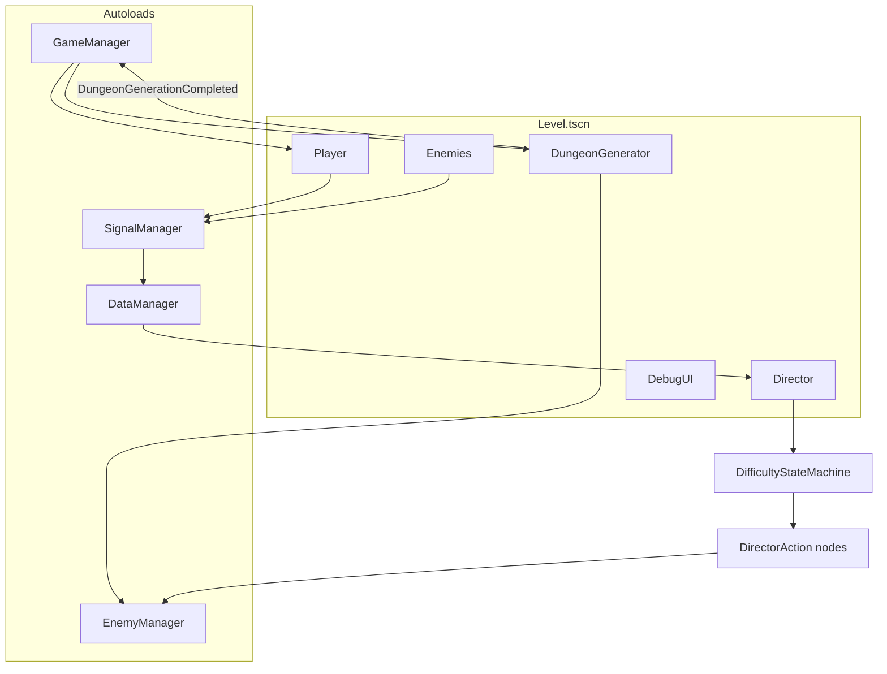
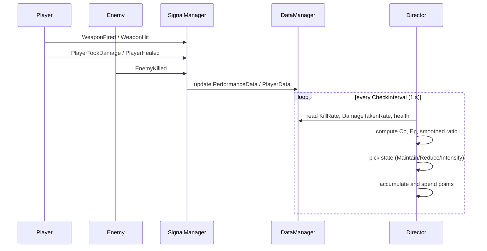

# Architecture

## Runtime overview

The game boots the `Level` scene declared in `project.godot` and relies on four autoload
singletons for cross-cutting state. The level then spawns the dungeon, the AI Director and the
debug UI.



The autoloads are registered in this order in `project.godot`: `DataManager`, `SignalManager`,
`EnemyManager`, `GameManager`. Keep that in mind when changing initialization code that reaches
for another singleton.

### Managers

| Manager | Responsibilities | Key API |
| --- | --- | --- |
| `SignalManager` | Central event hub. Declares all gameplay and debug signals. | `EnemyKilled`, `PlayerTookDamage`, `WeaponFired`, `PerformanceMetricsUpdated`, … |
| `DataManager` | Subscribes to gameplay signals, owns `DirectorData`, syncs player health, tracks spawned/living difficulty value. | `RegisterDirectorData`, `RegisterPlayer`, `RegisterEnemySpawn`, `RegisterEnemyDeath` |
| `EnemyManager` | Spawns enemies on a timer, keeps the active enemy list, builds an `AStarGrid2D` from the world tilemap and applies Director buffs/debuffs or spawn-rate changes. | `SetWorldTileMap`, `GetPath`, `ModifySpawnRate`, `BuffAllEnemies`, `DebuffAllEnemies`, `ForceSpawnEnemy` |
| `GameManager` | Session clock, session progress, current difficulty from `DifficultyCurve`, player registration and debug toggles. | `SessionTime`, `SessionProgress`, `CurrentDifficulty`, `RegisterPlayer` |

### Signal flow

Gameplay code does not call the Director directly. It emits through `SignalManager`; `DataManager`
aggregates the values and the Director samples them.



`DataManager` keeps both the 15-second windows used by the Director (`KillRate`,
`DamageTakenRate`) and shorter/longer buffers used by other metrics (6 s, 5 s, 30 s). See
[ai-director.md](ai-director.md) for the exact windows.

### Session lifecycle

1. Autoloads are added to the scene tree.
2. `Level._Ready()` connects to `DungeonGenerator.DungeonGenerationCompleted`.
3. `DungeonGenerator` generates and renders the dungeon; the physics separation step is
   asynchronous and completes on a deferred callback.
4. `OnDungeonGenerationCompleted` gives the world tilemap to `EnemyManager`, spawns the player at
   the starting room centre and attaches `PlayerCamera`.
5. `Director` evaluates performance every second and drives the `DifficultyStateMachine`.
6. `EnemyManager` keeps spawning enemies for `SessionDuration`; the spawn rate follows the
   difficulty curve and any active Director multiplier.

## Entities and components

| Type | Base | Responsibility |
| --- | --- | --- |
| `Player` | `CharacterBody2D` | WASD movement, mouse aiming, shooting, forwards health changes as damage/heal signals. Scene default speed is `600`. |
| `Enemy` | `Area2D` | Registers with `EnemyManager`, contact damage through `HitboxComponent`, death handling, runtime buff/debuff with visual feedback. |
| `EnemyRed` | `Enemy` | Aggro (200 px) / de-aggro (800 px), line-of-sight raycast, A* path following refreshed every 0.2 s. |
| `HealthComponent` | `Node2D` | HP, health bar, optional invincibility frames, `HealthChanged` and `Died` signals. |
| `HitboxComponent` | `Area2D` | Small bridge that forwards `Damage()` calls to a `HealthComponent`. |
| `PlayerBullet` | `Area2D` | Directional projectile with lifespan, pierce counter and tile collision cleanup. |
| `PlayerCamera` | `Camera2D` | Free-look camera with scroll-wheel zoom. |
| `DebugUi` | `CanvasLayer` | Renders Director state, Cp/Ep/ratio, points, spawn rate and recent actions. |

Composition is preferred over inheritance for reusable behaviour: enemies and the player share
the same `HealthComponent` / `HitboxComponent` scenes.

## Design patterns

- **Singleton** — managers exposed through `Instance` properties and registered as autoloads.
- **Observer** — Godot signals are used for gameplay-to-analytics communication.
- **State machine** — `DifficultyStateMachine` owns three `DirectorState` nodes.
- **Strategy** — each Director intervention is a `DirectorAction` subclass; selection is weighted
  and filtered by cost and cooldown.
- **Composition** — health and hitbox behaviour is attached to entities as child nodes.

## Source map

```text
Src/
├── AI Director/     Director, state machine, states, actions, data buffers
├── Components/      HealthComponent, HitboxComponent
├── Dungeon/         Generation pipeline and tile rendering
├── Enemies/         Enemy base class and EnemyRed implementation
├── Level/           Level scene orchestration
├── Managers/        Signal, Data, Enemy and Game managers
├── Player/          Player controller
├── Projectiles/     PlayerBullet
└── UI/              Camera and debug overlay
Tests/AIDirector/    GdUnit4 test suites
```

## Runtime caveats

- **Autoload order** matters when adding initialization code; do not assume a later autoload is
  ready inside an earlier one's `_Ready()`.
- **Local-only Godot-MCP addon** — `addons/godot_mcp` is intentionally not committed. The project
  still imports and exports without it; Godot logs a missing-editor-plugin error if the
  `[editor_plugins]` entry is present in a clean checkout.
- **Headless export warning** — Godot may log
  `Failed to get property '_stateNodes' from node 'DifficultyStateMachine'` while converting
  scenes during a headless import/export. It does not stop the export and the value is restored
  when the scene is instantiated at runtime.
- **Debug UI** is toggled by `GameManager.ShowDebugUi`; `ShowEnemyDebug` draws aggro ranges,
  de-aggro ranges, paths and line-of-sight rays.
