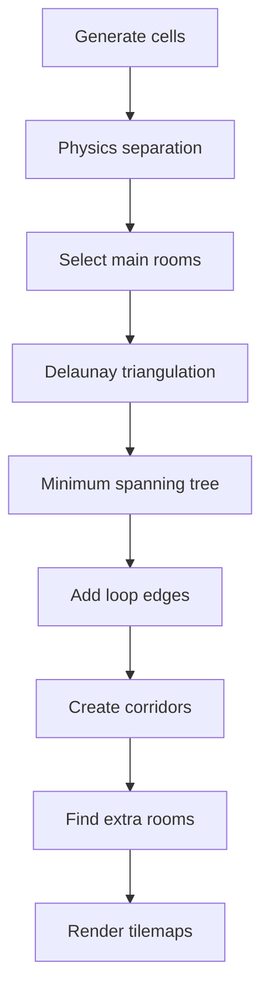

# Procedural Dungeon Generation

Each run builds a dungeon from a seed through a multi-stage pipeline. The pipeline is orchestrated
by `DungeonGenerator` and can optionally visualise every step.

## Pipeline stages

### 1. Cell generation — `RoomGenerator`

- Generates `NumberOfCells` rectangles (default 64) with random tile sizes between 15–31 × 7–16.
- Positions are distributed inside an ellipse (`CellSpawnRadiusX` = 60, `CellSpawnRadiusY` = 10)
  with a square-root radial distribution for uniform density.
- All randomness uses a seeded `RandomNumberGenerator`, so the same seed reproduces the layout.

### 2. Physics-based separation — `RoomSeparator`

- Every cell becomes a `RigidBody2D` with no gravity, locked rotation and a slightly expanded
  collision shape.
- A short physics simulation pushes overlapping cells apart; the simulation ends after 0.5 s of
  stability or a 10 s timeout.
- Final positions are snapped back to the tile grid and returned as `Rect2I`s.

### 3. Main room selection — `MainRoomDeterminator`

- Sorts cells by area and keeps the largest `LargestRoomsPercent` (default 25%).
- The starting room is the room closest to the centroid of all room centres.

### 4. Graph construction — `GraphGenerator`

- **Delaunay triangulation** (Bowyer–Watson with a super-triangle) over room centres.
- **Minimum spanning tree** with Kruskal's algorithm over the triangulation edges, guaranteeing
  connectivity.
- **Loops**: a percentage (`LoopPercent`, default 25%) of the remaining Delaunay edges is added
  back, so the dungeon is not a pure tree.
- Fallbacks create a complete graph or repair an incomplete MST if numerical edge cases occur.

### 5. Corridors — `HallwayGenerator`

- Tries straight corridors when the rooms overlap on an axis, otherwise builds an L-shaped path.
- Cells near the corridor line are painted into the room set and a direct tile-level brush
  guarantees a continuous corridor of `HallwayWidth` tiles (default 2).
- Corridors are inserted into the room list so later stages treat them as walkable space.

### 6. Extra rooms — `ExtraRoomDeterminator`

- Finds unused cells that are within `NeighborDistance` tiles (default 2) of the existing dungeon.
- Sorts neighbours by area and selects up to `ExtraRoomsPercent` (default 100%) of them.
- Extra rooms are currently **discovered and visualised**; they are not yet connected to the
  corridor graph or rendered as playable rooms.

### 7. Rendering — `DungeonRenderer` + `TilePlacer`

- The bounding box of all cells is filled with walls, then room and corridor floors are placed on
  `WorldTileMap` (the collision layer).
- Walls around rooms are removed where a corridor opens into the room.
- A final pass fills any remaining gaps around floor tiles with walls so the dungeon is sealed.
- `DisplayTileMap` is a purely visual layer: every world tile drives four display tiles, and
  `TilePlacer` maps the 16 possible corner configurations to atlas coordinates for a clean
  autotiled look.
- `WorldTileMap` and its wall/floor atlas coordinates are passed to `EnemyManager`, which builds
  the `AStarGrid2D` used by `EnemyRed`.

## Parameters

Exported on `DungeonGenerator`:

| Parameter | Default | Meaning |
| --- | --- | --- |
| `Seed` | `0` (random) | Reproducible layout seed; `0` picks a random seed |
| `NumberOfCells` | 64 | Candidate rectangles |
| `CellSpawnRadiusX/Y` | 60 / 10 | Elliptical distribution radii |
| `LargestRoomsPercent` | 0.25 | Fraction of cells promoted to rooms |
| `LoopPercent` | 0.25 | Fraction of non-MST edges added as loops |
| `ExtraRoomsPercent` | 1.0 | Fraction of neighbouring cells kept as extra rooms |
| `HallwayWidth` | 2 | Corridor width in tiles |
| `NeighborDistance` | 2 | Neighbour radius for extra rooms |
| `TileSize` | 16 | Tile size in pixels |
| `FloorAtlasCoord` / `WallAtlasCoord` | (1, 0) / (0, 0) | TileSet atlas coordinates |
| `WorldTileMap` / `DisplayTileMap` | scene nodes | Collision and visual layers |
| `EnableVisualization` | true | Animate the generation steps |
| `VisualizationStepDelay` | 0.5 s | Delay between visualised steps |
| `PhysicsTimeScale` | 0.02 | Slow-motion factor for separation |

`Level.tscn` overrides the scene defaults with `Seed = 111111` and
`EnableVisualization = false`.

## Runtime mutation

`DungeonMutator` (child `Mutator` of `DungeonGenerator`) exposes the runtime API used by Director
actions. It delegates all decisions to the scene-free `DungeonWorldModel`, so mutations can be
tested without a scene.

| API | Behaviour |
| --- | --- |
| `DungeonGenerator.Rooms` / `RoomCenters` / `CorridorEdges` | Read-only view of the generated dungeon; room geometry uses pixel coordinates, like the rest of the pipeline |
| `DungeonGenerator.GetFloorTiles()` | Current floor tiles from the collision tilemap |
| `DungeonGenerator.GetRoomTileRects()` / `GetRoomTileCenters()` | Main rooms in tile coordinates (corridor cells excluded), used by the mutator |
| `DungeonGenerator.RegisterRuntimeRoom(rect, center)` | Keeps the read-only view in sync after a runtime room is created |
| `DungeonTopology.ReachableFrom` / `AreAllReachable` | Four-way BFS over floor tiles |
| `DungeonTopology.FindBridges` | Tile-graph bridges (iterative Tarjan), deterministic |
| `DungeonTopology.FindPassages` | Corridor cross-sections of at most 3 tiles, excluding room interiors |
| `DungeonTopology.IsClosable` | Simulates a closure and checks every room centre plus the reference cell |
| `DungeonWorldModel.TryCreateRoom(area, openingSide)` | Validates bounds, overlap and occupied cells, carves the room and one tunnel, verifies reachability, rolls back on failure. The accepted room is reported through `LastCreatedRoom` / `LastCreatedRoomCenter` |
| `DungeonRoomPlacement.FindCandidates(...)` | Deterministic search for free room squares anchored to an existing floor tile, with a minimum player distance |
| `DungeonWorldModel.TryClosePassage(tiles)` | Replaces the cross-section with walls only when the dungeon stays connected; the model is unchanged otherwise |
| `DungeonWorldModel.RestoreFloors(tiles)` | Restores the exact tiles of a closed passage |
| `DungeonMutator.GetClosablePassages()` | Passages that can be closed right now |

Mutation rules:

- The room floor area must stay at least one tile inside the dungeon bounding box so the perimeter
  walls exist; rooms smaller than 3 × 3 tiles are rejected.
- Runtime rooms are anchored to an existing floor tile: `DungeonRoomPlacement` only proposes squares
  whose opening side touches a corridor or room, so the tunnel is either empty or at most one tile
  long.
- Any floor tile or entity cell (player, living enemies) inside the target area rejects the
  mutation. Cells are sampled from `GameManager.Player` and `EnemyManager.ActiveEnemies` before any
  tile is written.
- A passage is never closed when it covers the player cell or a room centre, or when the remaining
  floors would no longer connect every room centre. The check runs before the first write, so a
  rejected mutation leaves both tilemaps and the A* grid untouched.
- After a successful mutation the mutator repaints `WorldTileMap` (new floor tiles get wall
  neighbours), refreshes `DisplayTileMap` through `TilePlacer.UpdateDisplayTiles`, calls
  `EnemyManager.RebuildNavigation()` and emits `SignalManager.DungeonChanged`.
- The model is deterministic: tile iteration is sorted, so a fixed layout always produces the same
  passages and bridges.

## Visualisation

`GeneratorVisualizer` draws coloured overlays for cells, selected rooms, Delaunay edges, the MST,
loop edges, corridors and extra rooms. Enable it when tuning the generator; leave it off for
normal gameplay and CI exports.

## Known limitations

- Extra rooms are not connected to the graph yet.
- The renderer receives an empty corridor-position list in the current call; corridor connectivity
  is guaranteed by the tile painting stage instead.
- Very small room counts (fewer than two) abort graph construction with a logged error.
- All geometry is axis-aligned; there are no diagonal corridors.
